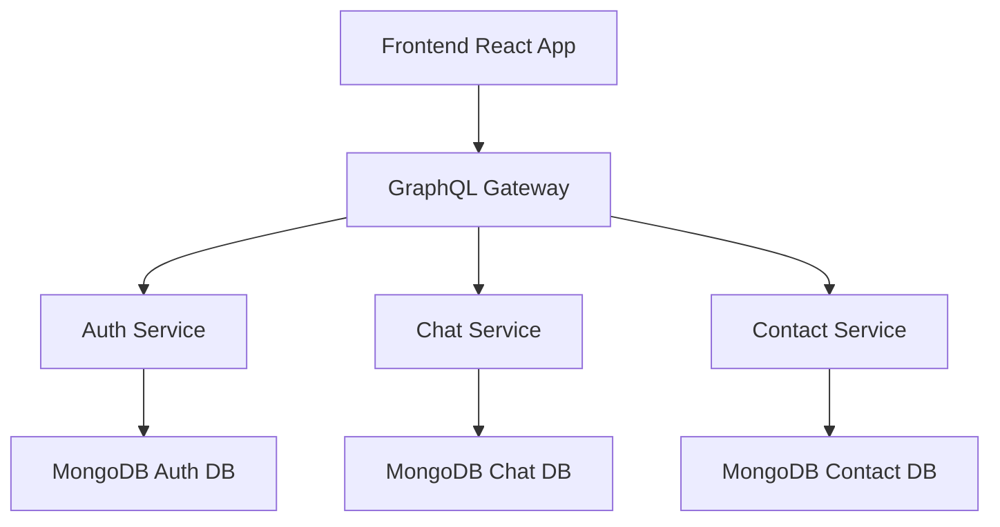

# MERN Chat Application

A real-time chat application: a React client, a GraphQL gateway, and three Express services. Each service has its own MongoDB.

## Architecture

The gateway is a backend-for-frontend. It owns one GraphQL schema and calls the services over REST. The services do not expose GraphQL, and this repo does not use Apollo Federation or DataLoader.



| Piece | Role | Port | Database |
|---|---|---|---|
| Frontend | React 18, Vite, Apollo Client, Redux Toolkit, MUI | 3000 | — |
| Gateway | Apollo Server 4, GraphQL queries, mutations, and WebSocket subscriptions | 3001 | — |
| Auth | Users, password hashes, JWT | 5000 | MongoDB 27018 |
| Contact | Contact requests | 4000 | MongoDB 27019 |
| Chat | Rooms and messages | 4500 | MongoDB 27020 |

Signup copies `_id`, email, and username into chat and contact. Passwords stay in auth. If a later copy fails, the gateway deletes the copies it already wrote. A username change is rolled back the same way.

Subscriptions (`newMessage`, `newContactRequest`, `newContact`, `newChatRoom`) use an in-process pub/sub in the gateway process. `newMessage` is limited to one chat room and to participants of that room. The other three are limited to the signed-in user who is a party to the event. They are not shared across multiple gateway processes.

## Quick start

### Prerequisites

- Node.js 18+
- Docker and Docker Compose, for the full stack

### Docker Compose

```bash
git clone https://github.com/julihocc/mern-chat-app.git
cd mern-chat-app
docker compose -f docker-compose.yaml up
```

Compose sets `JWT_SECRET`, `INTERNAL_API_TOKEN=dev-internal-token`, `CLIENT_ORIGIN`, and the `VITE_GATEWAY_*` URLs used by the Vite dev server. There is no production compose file in this repo.

### Local processes

Install and start each service in its own directory. There is no root `package.json`.

```bash
cd authService && npm install && npm start      # 5000
cd chatService && npm install && npm start      # 4500
cd contactService && npm install && npm start   # 4000
cd gateway && npm install && npm start          # 3001
cd frontend && npm install && npm run dev       # 3000
```

Local runs use `INTERNAL_API_TOKEN=dev-internal-token` when the variable is unset. Set the same value on the gateway and the three services. Set `JWT_SECRET` on auth. Set `CLIENT_ORIGIN` on the gateway when the browser origin is not `http://localhost:3000`.

The Vite client reads `VITE_GATEWAY_HTTP_URL` and `VITE_GATEWAY_WS_URL`. The defaults are `http://localhost:3001` and `ws://localhost:3001`.

### Access

- Frontend: http://localhost:3000
- GraphQL: http://localhost:3001/graphql
- Auth, contact, and chat listen on 5000, 4000, and 4500. Callers must send `x-internal-token`.

## Scripts

Frontend:

```bash
cd frontend
npm test
npm run test:watch
npm run test:coverage
npm run test:ui
```

Vitest, React Testing Library, and MSW are set up under `frontend/`. See `frontend/TESTING.md`.

Auth, chat, and the gateway define `npm test` as a failing placeholder. Contact has no test script.

## Kubernetes

Manifests for Minikube live under `minikube/`. Older AWS and Minikube files are under `minikube/__legacy/`.

```bash
minikube start
kubectl apply -f minikube/auth-service/
kubectl apply -f minikube/chat-service/
kubectl apply -f minikube/contact-service/
kubectl apply -f minikube/gateway/
kubectl apply -f minikube/frontend/
```

Those manifests do not set `INTERNAL_API_TOKEN` or `CLIENT_ORIGIN`. A cluster deploy needs those values, plus `JWT_SECRET`, before the services will accept the gateway.

## Security

- The browser session is an httpOnly cookie named `authToken`. The Apollo client sends it with `credentials: 'include'`. A non-browser client can still send `Authorization: Bearer <jwt>`.
- Auth compares passwords with `POST /v1/password/compare`. User JSON does not include the password hash.
- Auth, chat, and contact require header `x-internal-token`. Compose sets `INTERNAL_API_TOKEN=dev-internal-token`. Production must set its own value. The dev default is only for a laptop.
- Gateway CORS allows `CLIENT_ORIGIN` (default `http://localhost:3000`) with credentials.
- Rate limit on each process: 10,000 requests per hour per IP.
- Passwords are hashed with bcrypt.

## Project layout

```
mern-chat-app/
├── authService/
├── chatService/
├── contactService/
├── gateway/
├── frontend/
├── minikube/
└── docker-compose.yaml
```

## License

Service `package.json` files declare ISC or MIT. This repository does not include a LICENSE file.
